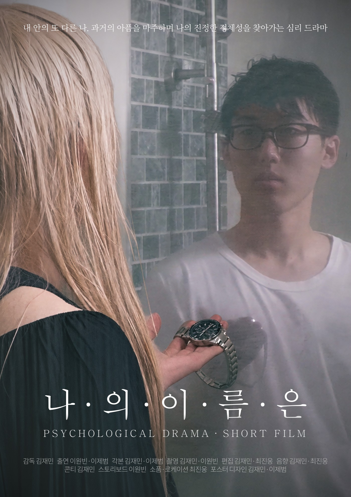
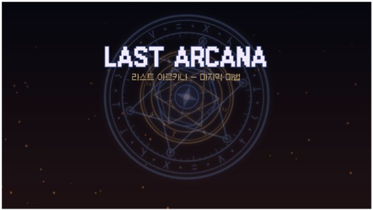

# 이원빈 | 영상 제작 · 게임 기획

> 이야기를 영상과 게임으로 구현하는 미디어콘텐츠 전공자입니다.

안녕하세요. 미디어콘텐츠학과을 전공한 **이원빈**입니다. 영상 촬영·편집과 게임 기획·제작에 관심을 두고, 팀 기반의 영상 제작과 개인 게임 프로젝트를 통해 기획 의도를 콘텐츠로 구현하는 경험을 쌓고 있습니다.

[관심 분야](#관심-분야) · [사용 도구](#사용-도구) · [대표 프로젝트](#대표-프로젝트) · [앞으로의 목표](#앞으로의-목표)

## 관심 분야

- **영상 촬영 및 편집**: 장면 구성과 편집을 통해 이야기와 인물의 감정을 전달하는 작업에 관심이 있습니다.
- **게임 기획 및 제작**: 이야기와 플레이 경험을 연결하고, 기획한 내용을 실제 게임으로 구현하는 과정에 관심이 있습니다.

## 사용 도구

| 구분 | 사용해 본 도구 |
| --- | --- |
| 영상·이미지 제작 | Adobe Premiere Pro, Adobe Photoshop, Adobe Illustrator |
| 생성형 AI | ChatGPT, Gemini, Claude, Suno |

영상 졸업작품 제작 과정에서 Adobe 제작 도구와 생성형 AI를 사용했으며, 개인 게임 프로젝트에서도 AI 도구를 활용했습니다. 각 프로젝트에서 직접 맡은 작업은 아래에 정리했습니다.

## 대표 프로젝트

### 01. 나의 이름은

**4인 팀 졸업작품 · 심리 드라마**

  

*〈나의 이름은〉 작품 포스터*

#### 프로젝트 소개

과거의 트라우마로 분열된 두 인격이 충돌하는 심리 드라마입니다. 인물의 내면 갈등과 정체성을 마주하는 과정을 영상으로 표현한 4인 팀 졸업작품입니다.

#### 담당 역할과 제작 경험

- **촬영**: 작품의 장면을 촬영하며 영상 제작에 참여했습니다.
- **연기**: 배우로 출연하여 인물의 감정과 상황을 표현했습니다.
- **연출 참여**: 팀원들과 함께 장면의 표현과 연출을 논의하고 제작에 참여했습니다.
- **발표 자료 제작**: 작품을 소개하기 위한 PPT 자료를 제작했습니다.

#### 제작 결과

팀원들과 역할을 분담하여 심리 드라마 영상 작품을 제작했습니다. 촬영과 연기를 함께 경험하며, 카메라에 담기는 장면과 배우의 표현을 함께 고려하는 제작 과정을 경험했습니다.

**사용 도구**: Adobe Premiere Pro, Adobe Photoshop, Adobe Illustrator, ChatGPT, Gemini, Claude, Suno

---

### 02. 라스트 아르카나

**개인 프로젝트 · 마법 액션 어드벤처 게임**

  

*〈라스트 아르카나〉 게임 타이틀 화면*

#### 프로젝트 소개

마법을 소재로 한 액션 어드벤처 게임입니다. 개인 프로젝트로 게임의 방향을 기획하고, 연출과 제작을 수행했습니다.

#### 담당 역할과 제작 경험

- **게임 기획**: 마법 액션 어드벤처라는 장르와 제작 방향을 설정했습니다.
- **연출**: 게임의 콘셉트를 전달하기 위한 표현과 연출을 구성했습니다.
- **제작**: ChatGPT, Claude, Suno를 활용하여 기획한 게임을 제작했습니다.

#### 제작 결과

기획부터 연출과 제작까지 직접 수행하며, 아이디어를 게임 결과물로 구현하는 과정을 경험했습니다. 위 이미지는 제작한 게임의 타이틀 화면입니다.

**사용 도구**: ChatGPT, Claude, Suno

## 앞으로의 목표

**영상 편집과 콘텐츠 기획 역량을 심화하는 것**이 목표입니다. 영상과 게임 제작 경험을 바탕으로 매체의 특성에 맞는 스토리텔링과 표현 방식을 익히고, 기획 의도를 명확하게 전달하는 콘텐츠 제작자로 성장하고자 합니다.
